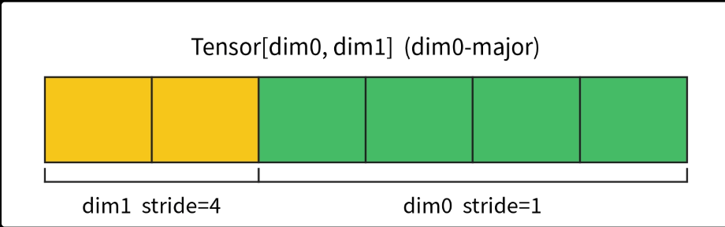
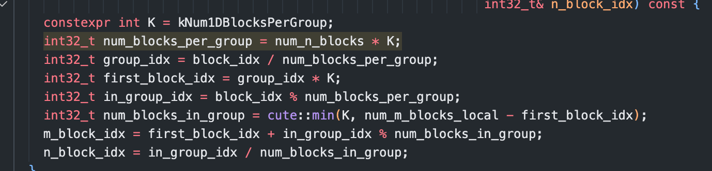

## 1. Overview

Data tiling is an important part of modern GPU programming. To make full use of GPU parallelism, we divide tensor data among threads according to a set of rules, so that each thread holds a group of elements. By coordinating multiple warps, warp groups, or even SMs, we can compute several results at once.

From an engineering perspective, there are two approaches: LinearLayout, as used in Triton, and layout algebra, as used in CuTe.

The following sections explain how these ideas work, from both mathematical and engineering perspectives.

## 2. Tensors

### 2.1 Logical tensors

Tensors are central to computation in deep learning. A tensor can be viewed as multidimensional data in C, with a potentially different length along each dimension. Here, however, we prefer the following definition:

$$
\mathcal{T} = (\mathit{data},\; \mathit{shape},\; \mathit{stride})
\tag{1}
$$

where:

- $data \in \mathbb{R}^{N}$: the underlying one-dimensional storage array
- $shape = (s_0, s_1, \dots, s_{d-1}) \in \mathbb{N}^{d}$, $d$ is the number of dimensions; dimension $i$ has length $s_i$
- $stride = (t_0, t_1, \dots, t_{d-1}) \in \mathbb{Z}^{d}$; $t_i$ gives the increase in the underlying array index when the coordinate in that dimension increases by one

A dense tensor satisfies the following constraint:

$$
t_{i} = s_{i-1} \cdot t_{i-1},\quad t_0 = 1
\tag{2}
$$

Each rank can be viewed as a pair ($\boldsymbol{shape}$,  $\boldsymbol{stride}$), where $\boldsymbol{shape}$ describes the length in the current rank's coordinate system, while $\boldsymbol{stride}$ describes the position of a basis coordinate in the current sub-coordinate system. In summary, $\boldsymbol{shape}$ represents length, and $\boldsymbol{stride}$ represents direction.

### 2.2 Physical tensors

The previous section defined a logical tensor. The word logical matters: it describes how we interpret data mathematically. A computer's storage representation is usually different. From the perspective of memory or storage, it treats the data as follows:

$$
\mathcal{M} = (data,\; offset,\; length)
\tag{3}
$$

where:

- $data \in \mathbb{R}^{M}$: the underlying one-dimensional storage array
- $offset \in \mathbb{N}$: the starting offset of this memory segment
- $length \in \mathbb{N}$: the number of elements in the memory segment

### 2.3 Establishing the mapping

One important task of compilers and SDKs is to connect the logical structure of a <mark>tensor</mark> to its execution on hardware. This requires describing the tensor's shape and indexing relationships, as well as how its elements are stored, accessed, and assigned to threads.

Layout algebra gives these relationships a common mathematical description. While preserving the semantics of the logical tensor, it is primarily used to:

- **Describe storage layouts**: map logical indices to physical storage locations and describe how tensor elements are arranged in memory.
- **Express layout transformations**: describe layout composition, decomposition, and transformation in a common mathematical form, providing a basis for index calculations and data rearrangement.
- **Connect layouts to hardware execution**: describe data distribution and access across threads, and match these relationships to the memory hierarchy and hardware instruction requirements.

## 3. Layout algebra

### 3.1 Mathematical principles

In Section $\boldsymbol{2.1}$, we described a tensor layout in terms of $\boldsymbol{shape}$ and $\boldsymbol{stride}$. We can express this layout formally as follows:

$$
\bold{(s_0, s_1, \dots, s_{d-1}):(t_0, t_1, \dots, t_{d-1})}
\tag{4}
$$

The tuple before the colon gives the length of each dimension. The tuple after the colon gives the corresponding strides.

For example, $\bold{(4, 8):(8, 1)}$ describes two dimensions of lengths 4 and 8, with corresponding strides of 8 and 1. In other words, this is a dense tensor in which $\boldsymbol{dim1}$ varies fastest, with shape $\bold{4x8}$.

Given this definition, a tensor layout written in the form of equation [(4)](#eq4) lets us map multidimensional coordinates to a one-dimensional offset, denoted by x:

$$
(x_0,x_1,\dots,x_\alpha) \mapsto x_0 + x_1\cdot M_0 + x_2\cdot M_0 M_1 + \dots + x_\alpha \cdot M_0 M_1 \cdots M_{\alpha-1}
\tag{5}
$$

The inverse mapping can be written in the same way:

$$
x \mapsto
\left(
x \bmod s_0,\;
\left\lfloor \frac{x}{s_0} \right\rfloor \bmod s_1,\;
\dots,\;
\left\lfloor
\frac{x}{s_0 s_1 \cdots s_{d-2}}
\right\rfloor \bmod s_{d-1}
\right)
\tag{6}
$$

### 3.2 Engineering perspective

Take a two-dimensional tensor whose dimensions are $dim0$ and $dim1$, with element coordinates $(x_0, x_1)$. From an engineering perspective, we need to calculate the element's storage offset relative to the start of the tensor, namely $offset$.

The diagram below uses a storage layout in which dimension $0$ varies fastest. The strides are $t_0 = 1$ and $t_1 = 4$:

The colored blocks represent elements arranged contiguously in the underlying storage. Yellow and green distinguish the regions in the diagram. An element's $offset$ denotes its displacement from the start of the tensor, measured in elements. When the coordinate in dimension $0$ increases by $1$, the storage position advances by $1$ element; when the coordinate in dimension $1$ increases by $1$, the storage position advances by $4$ elements. Therefore, the storage offset of any element is:

$$
\operatorname{offset}(x_0, x_1)
= x_0 t_0 + x_1 t_1
= x_0 + 4x_1.
$$

For example, the element $tensor[1, 1]$ has storage offset $1 + 4 \times 1 = 5$. If the tensor's base address is $base$ and each element occupies $b$ bytes, the element's address is $base + 5b$.

For a $d$-dimensional tensor, the rule stays the same: multiply each coordinate by the corresponding stride, then sum the contributions:

$$
\operatorname{offset}(x_0, x_1, \dots, x_{d-1})
= \sum_{i=0}^{d-1} x_i t_i.
$$

From this perspective, $shape$ defines the range of coordinates in each dimension, and $stride$ defines how far storage advances when moving along that dimension. Together, they describe the mapping from logical coordinates to storage offsets.

The distinction is that the one-dimensional index constructed solely from $shape$ in the previous section describes logical traversal order, whereas the actual $offset$ is determined by the $stride$. The two coincide when $t_0 = 1$ and $t_i = \prod_{j=0}^{i-1}s_j$.

With this mapping in mind, it becomes easier to understand why GPU code often contains repetitive, hard-to-follow index calculations such as the following:

In principle, this code works. However, it offers limited support for layout transformations and is harder to maintain. Next, we will look at Triton and CuTe, two successful implementations, to see how layout algebra is used in practice.
