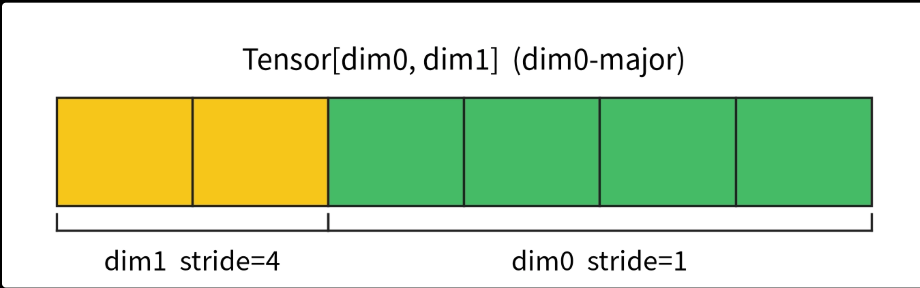

## 1. Overview

在现代GPU编程中DataTiling是一件非常重要的事情。简单来说，如果我们要充分发挥GPU并发的优势，我们就需要把Tensor数据按照一定的规则划分到每个线程上，最终让每个thread都持有一组数据。这样当我协同多wrap或者多wrap group， 甚至多sm的时候，我们就可以一次性计算出多个结果。

目前从工程角度看，有2种不同的实现。一个是以Triton为代表的LinearLayout；另外一个就是以Cute为代表的布局代数。

下面的章节会从数学原理、工程实现的角度去解释其工作原理。

## 2. 张量

### 2.1 逻辑张量

在深度学习中，Tensor是所有计算的核心。Tensor可以简单的认为是C语言中的多维数据，同时每个维度都可以有不同的长度。但在本文中我们更愿意以下面的方式来定义Tensor：
$$
\mathcal{T} = (\mathit{data},\; \mathit{shape},\; \mathit{stride})
\tag{1}
$$
其中：

- $data \in \mathbb{R}^{N}$：底层一维存储数组 
- $shape = (s_0, s_1, \dots, s_{d-1}) \in \mathbb{N}^{d}$，$d$ 为张量维度；第 $i$ 维长度 $s_i$ 
-  $stride = (t_0, t_1, \dots, t_{d-1}) \in \mathbb{Z}^{d}$；$t_i$ 表示该维度下标每 +1，底层数组下标增量 

同时对于一个稠密的张量来说， 其一定满足如下的约束：
$$
t_{i} = s_{i-1} \cdot t_{i-1},\quad t_0 = 1
\tag{2}
$$
我们可以认为每个rank的可以视作是（$\boldsymbol{shape}$， $\boldsymbol{stride}$）的一个组合，$\boldsymbol{shape}$代表当前rank坐标系中的长度；而$\boldsymbol{stride}$可以认为是当前子坐标系的基坐标点位置。总结一下，$\boldsymbol{shape}$代表长度；而$\boldsymbol{stride}$代表方向。

### 2.2 物理张量

在上一个章节我们描述和定义了逻辑张量。其中逻辑二字非常重要，其代表从数学或是人的角度是如何解释一组数据的。但是计算机在存储的时候往往不是按照这种方式去做的。计算机不论是从内存视角还是存储视角都将数据看做是如下形式：
$$
\mathcal{M} = (data,\; offset,\; length)
\tag{3}
$$

其中： 

- $data \in \mathbb{R}^{M}$：底层一维存储数组 
- $offset \in \mathbb{N}$：该内存片段的起始偏移 
- $length \in \mathbb{N}$：该内存片段包含元素个数

### 2.3 建立映射关系

编译器与 SDK 的一项重要任务，是连接<mark>张量</mark>的逻辑结构与硬件上的实际执行方式：既要描述张量的形状与索引关系，也要明确其元素如何存储、访问，以及如何分配给线程处理。

布局代数为这些关系提供了统一的数学描述。在保持逻辑张量语义不变的前提下，它主要用于：

- **描述存储布局**：建立逻辑索引到物理存储位置的映射，刻画张量元素在内存中的排布。
- **表达布局变换**：用统一的数学形式描述布局的组合、分解与变换，为索引计算和数据重排提供依据。
- **衔接硬件执行**：描述数据在各线程之间的分配及访问关系，并与存储层次和硬件指令的要求相匹配。

## 3. 布局代数

### 3.1 数学原理

在章节$\boldsymbol{2.1}$中我们将一个张量的布局抽象成了$\boldsymbol{shape}$和$\boldsymbol{stride}$，为了更好的描述。我们使用如下的形式化方式来表述一个张量布局方式：

$$
\bold{(s_0, s_1, \dots, s_{d-1}):(t_0, t_1, \dots, t_{d-1})}
\tag{4}
$$
前面代表当前张亮的每个维度的长度， 冒号后代表每个维度的stride。

举个例子：$\bold{(4, 8):(8, 1)}$代表当前有两个维度分别为4和8，同时其对应的stride分别为8和1。说人话就是其代表一个$\boldsymbol{dim1}$优先的大小为$\bold{4x8}$的稠密张量。

有了形式化定义后，对于一个以公式 [(4)](#eq4) 的形式表示的张量布局来说，我们可以使用如下的方式将多维坐标转化为offset（其中x为offset）：
$$
(x_0,x_1,\dots,x_\alpha) \mapsto x_0 + x_1\cdot M_0 + x_2\cdot M_0 M_1 + \dots + x_\alpha \cdot M_0 M_1 \cdots M_{\alpha-1}
\tag{5}
$$
当然反过来也是一样的。
$$
x \mapsto
\left(
x \bmod s_0,\;
\left\lfloor \frac{x}{s_0} \right\rfloor \bmod s_1,\;
\dots,\;
\left\lfloor
\frac{x}{s_0 s_1 \cdots s_{d-2}}
\right\rfloor \bmod s_{d-1}
\right)
\tag{6}
$$

### 3.2 工程视角

以一个二维张量为例，将两个维度记为 $dim0$ 和 $dim1$，元素在这两个维度上的坐标记为 $(x_0, x_1)$。从工程视角看，我们需要根据这组坐标，计算该元素相对于张量起始位置的存储偏移，也就是 $offset$。

下图采用第 $0$ 维坐标变化最快的存储布局，其两个维度的步长分别为 $t_0 = 1$ 和 $t_1 = 4$：

图中的色块可以看作底层存储中连续排列的元素。黄色和绿色用于辅助区分图中的区域，元素的 $offset$ 则表示它相对于张量起始位置的偏移。这里的偏移以元素个数为单位：第 $0$ 维坐标每增加 $1$，存储位置前进 $1$ 个元素；第 $1$ 维坐标每增加 $1$，存储位置前进 $4$ 个元素。因此，任意元素的存储偏移为：

$$
\operatorname{offset}(x_0, x_1)
= x_0 t_0 + x_1 t_1
= x_0 + 4x_1.
$$

例如，元素 $tensor[1, 1]$ 的存储偏移为 $1 + 4 \times 1 = 5$。如果张量的起始地址为 $base$，且每个元素占用 $b$ 字节，那么该元素的地址就是 $base + 5b$。

推广到 $d$ 维张量，计算方法保持不变：将每一维的坐标乘以该维的 stride，再将各维贡献的偏移相加，即：

$$
\operatorname{offset}(x_0, x_1, \dots, x_{d-1})
= \sum_{i=0}^{d-1} x_i t_i.
$$

从这个角度看，$shape$ 确定各维坐标的取值范围，$stride$ 确定沿各维移动时的存储步长，两者共同描述了从逻辑坐标到存储偏移的映射。

需要区分的是，上一节仅根据 $shape$ 构造的一维编号描述的是逻辑遍历顺序，而这里的 $offset$ 由实际的 $stride$ 决定。当 $t_0 = 1$ 且 $t_i = \prod_{j=0}^{i-1}s_j$ 时，两者一致。
