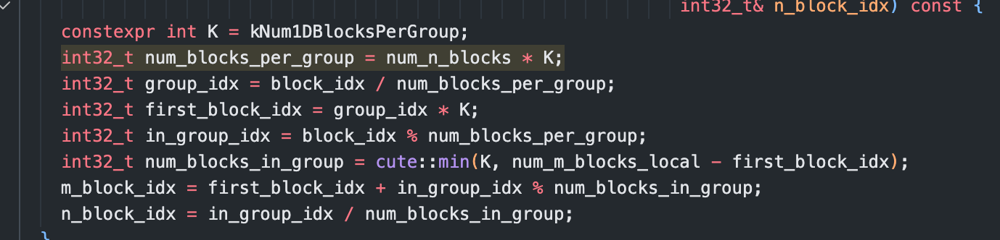
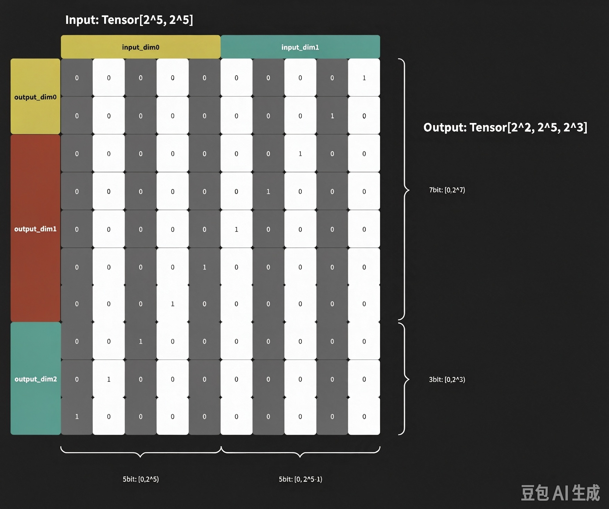

[toc]

## 1. Overview

在现代GPU编程中DataTiling是一件非常重要的事情。简单来说，如果我们要充分发挥GPU并发的优势，我们就需要把Tensor数据按照一定的规则划分到每个线程上，最终让每个thread都持有一组数据。这样当我协同多wrap或者多wrap group， 甚至多sm的时候，我们就可以一次性计算出多个结果。

目前从工程角度看，有2种不同的实现。一个是以Triton为代表的LinearLayout；另外一个就是以Cute为代表的布局代数。

下面的章节会从数学原理、工程实现的角度去解释其工作原理。


## 2. 张量

### 2.1 逻辑张量

在深度学习中，Tensor是所有计算的核心。Tensor可以简单的认为是C语言中的多维数据，同时每个维度都可以有不同的长度。但在本文中我们更愿意以下面的方式来定义Tensor：
$$
\mathcal{T} = (\mathit{data},\; \mathit{shape},\; \mathit{stride})
\tag{1}
$$
其中：

- $data \in \mathbb{R}^{N}$：底层一维存储数组 
- $shape = (s_0, s_1, \dots, s_{d-1}) \in \mathbb{N}^{d}$，$d$ 为张量维度；第 $i$ 维长度 $s_i$ 
-  $stride = (t_0, t_1, \dots, t_{d-1}) \in \mathbb{Z}^{d}$；$t_i$ 表示该维度下标每 +1，底层数组下标增量 

同时对于一个稠密的张量来说， 其一定满足如下的约束：
$$
t_{i} = s_{i-1} \cdot t_{i-1},\quad t_0 = 1
\tag{2}
$$
我们可以认为每个rank的可以视作是（$\boldsymbol{shape}$， $\boldsymbol{stride}$）的一个组合，$\boldsymbol{shape}$代表当前rank坐标系中的长度；而$\boldsymbol{stride}$可以认为是当前子坐标系的基坐标点位置。总结一下，$\boldsymbol{shape}$代表长度；而$\boldsymbol{stride}$代表方向。


### 2.2 物理张量

在上一个章节我们描述和定义了逻辑张量。其中逻辑二字非常重要，其代表从数学或是人的角度是如何解释一组数据的。但是计算机在存储的时候往往不是按照这种方式去做的。计算机不论是从内存视角还是存储视角都将数据看做是如下形式：
$$
\mathcal{M} = (data,\; offset,\; length)
\tag{3}
$$


其中： 

- $data \in \mathbb{R}^{M}$：底层一维存储数组 
- $offset \in \mathbb{N}$：该内存片段的起始偏移 
- $length \in \mathbb{N}$：该内存片段包含元素个数


### 2.3 建立映射关系

编译器与 SDK 的一项重要任务，是连接<mark>张量</mark>的逻辑结构与硬件上的实际执行方式：既要描述张量的形状与索引关系，也要明确其元素如何存储、访问，以及如何分配给线程处理。

布局代数为这些关系提供了统一的数学描述。在保持逻辑张量语义不变的前提下，它主要用于：

- **描述存储布局**：建立逻辑索引到物理存储位置的映射，刻画张量元素在内存中的排布。
- **表达布局变换**：用统一的数学形式描述布局的组合、分解与变换，为索引计算和数据重排提供依据。
- **衔接硬件执行**：描述数据在各线程之间的分配及访问关系，并与存储层次和硬件指令的要求相匹配。


## 3. 布局代数

### 3.1 数学原理

在章节$\boldsymbol{2.1}$中我们将一个张量的布局抽象成了$\boldsymbol{shape}$和$\boldsymbol{stride}$，为了更好的描述。我们使用如下的形式化方式来表述一个张量布局方式：

<span id="eq4"></span>

$$
\bold{(s_0, s_1, \dots, s_{d-1}):(t_0, t_1, \dots, t_{d-1})}
\tag{4}
$$
前面代表当前张亮的每个维度的长度， 冒号后代表每个维度的stride。

举个例子：$\bold{(4, 8):(8, 1)}$代表当前有两个维度分别为4和8，同时其对应的stride分别为8和1。说人话就是其代表一个$\boldsymbol{dim1}$优先的大小为$\bold{4x8}$的稠密张量。


有了形式化定义后，对于一个以公式 [(4)](#eq4) 的形式表示的张量布局来说，我们可以使用如下的方式将多维坐标转化为offset（其中x为offset）：
$$
(x_0,x_1,\dots,x_\alpha) \mapsto x_0 + x_1\cdot M_0 + x_2\cdot M_0 M_1 + \dots + x_\alpha \cdot M_0 M_1 \cdots M_{\alpha-1}
\tag{5}
$$
当然反过来也是一样的。
$$
x \mapsto
\left(
x \bmod s_0,\;
\left\lfloor \frac{x}{s_0} \right\rfloor \bmod s_1,\;
\dots,\;
\left\lfloor
\frac{x}{s_0 s_1 \cdots s_{d-2}}
\right\rfloor \bmod s_{d-1}
\right)
\tag{6}
$$

### 3.2 工程视角

以一个二维张量为例，将两个维度记为 $dim0$ 和 $dim1$，元素在这两个维度上的坐标记为 $(x_0, x_1)$。从工程视角看，我们需要根据这组坐标，计算该元素相对于张量起始位置的存储偏移，也就是 $offset$。

下图采用第 $0$ 维坐标变化最快的存储布局，其两个维度的步长分别为 $t_0 = 1$ 和 $t_1 = 4$：


图中的色块可以看作底层存储中连续排列的元素。黄色和绿色用于辅助区分图中的区域，元素的 $offset$ 则表示它相对于张量起始位置的偏移。这里的偏移以元素个数为单位：第 $0$ 维坐标每增加 $1$，存储位置前进 $1$ 个元素；第 $1$ 维坐标每增加 $1$，存储位置前进 $4$ 个元素。因此，任意元素的存储偏移为：

$$
\operatorname{offset}(x_0, x_1)
= x_0 t_0 + x_1 t_1
= x_0 + 4x_1.
\tag{7}
$$

例如，元素 $tensor[1, 1]$ 的存储偏移为 $1 + 4 \times 1 = 5$。如果张量的起始地址为 $base$，且每个元素占用 $b$ 字节，那么该元素的地址就是 $base + 5b$。

推广到 $d$ 维张量，计算方法保持不变：将每一维的坐标乘以该维的 stride，再将各维贡献的偏移相加，即：

<span id="eq8"></span>

$$
\operatorname{offset}(x_0, x_1, \dots, x_{d-1})
= \sum_{i=0}^{d-1} x_i t_i.
\tag{8}
$$

从这个角度看，$shape$ 确定各维坐标的取值范围，$stride$ 确定沿各维移动时的存储步长，两者共同描述了从逻辑坐标到存储偏移的映射。

需要区分的是，上一节仅根据 $shape$ 构造的一维编号描述的是逻辑遍历顺序，而这里的 $offset$ 由实际的 $stride$ 决定。当 $t_0 = 1$ 且 $t_i = \prod_{j=0}^{i-1}s_j$ 时，两者一致。


在此基础上，我们就很容易理解为什么GPU代码中充斥如下冗余和不易理解的代码：



从理论上讲这样的代码没啥问题。  但是缺少了一些变换方式与可维护性。下面我们会从$\bold{Triton}$和$\bold{Cute}$两个成功的工程实现看看业界是如何将布局代数落地的。


## 4. LinearLayout

### 4.1 overview

$\bold{Triton}$是OpenAI发布的算子DSL编译器。其目的是以Block而非thread为编程原子核心，普通开发者只需要关注一个Tile内部（也就是Block视角下要处理的张量规模）的数据划分和操作就可以了，而不需要关注一个thread内部情况。但是开发者不关心并不代表问题就会消失。承担这一切的是$\bold{Triton}$编译器中的$\bold{LinearLayout}$。


### 4.2 工程实现

#### 4.2.1 数据结构

我们使用公式 [(4)](#eq4) 中的形式化方式来表示一个张量。其内部有如下几个信息：

- 维度名($\bold{label}$)： $\bold{(s_0, s_1, \dots, s_{d-1})}$

* 维度长度($\bold{length}$)：$\bold{|s_0|, |s_1|, \dots}$

* 维度偏移($\bold{offset}$)： $\bold{(t_0, t_1, \dots, t_{d-1})}$

同时对于稠密型张量，其满足公式 [(8)](#eq8) 。同时如果每个维度长度都满足如下条件：
$$
\forall\, i\in\{0,\dots,d-1\},\ \exists\, n_i\in\mathbb{N}:\ s_i = 2^{n_i}
\tag{9}
$$
那我们就可以将这些信息简化到如下的图中：



首先这张图的横坐标在最上面有名为$\bold{input\_dim0}$和$\bold{input\_dim1}$的两个label，来表示一个输入张量的两个维度。在每个label下面有黑白相间的框代表一个bit位，有多少个bit位就代表当前维度的尝试是多少。比如以$\bold{input\_dim0}$为例，其下面有5个bit，因此其长度为$\bold{2^5}$。同理输出维度也具有相同的语义。

> **注意**
>
> 这里需要特别的强调的是$\bold{LinearLayout}$同时支持开发者设置输入张量布局和输出张量布局。
>
> 这也就意味着实际上这个$\bold{LinearLayout}$实际上是支持$\bold{view}$功能。

最后，我们需要注意的是在这个表格中有部分的bit值是1（绝大多数都是0）。这个代表当前输入维度对对应输出维度的位有贡献。

有了这个基础我们看看LinearLayout的数据机构是如何定义的。

``` cpp
class LinearLayout {
private:
  // bases[inDim][i] = L(0, ..., inDim=2^i, ..., 0).  All other values of L are
  // computed by xor'ing bases together, using the linearity rule.  In addition:
  //
  // - Each inDim has the same set of outDims, in the same order.
  // - The order of dims is minor-to-major, although this only affects reshape.
  llvm::MapVector<StringAttr /*inDim*/,
                  std::vector<std::vector<int32_t> /*size=getNumOutDims()*/>
                  /*size=getInDimSizeLog2(inDim)*/>
      bases;

  llvm::MapVector<StringAttr, int32_t /*size*/> outDims;
  int32_t rank = 0;
  ...
};    
```

这里的$\bold{bases}$就是我们上面画的表格：

- $\bold{StringAttr}$： 输入维度的label名字，等价于$\bold{input\_dim0}$和$\bold{input\_dim1}$；
- $\bold{std::vector<std::vector<int32\_t>>}$：外部长度代表当前label下由几个bit组成，因此这里的size的二次幂其实是当前输入维度的长度；内部维度代表了当前bit对多个输出维度有哪些贡献，其长度实际上是输出维度的长度；

- $\bold{outDims}$： 实际上是输出维度的信息，等价于表格的左边轴向label；
- $\bold{rank}$：代表当前的秩（rank）。


#### 4.2.2 布局构造

##### 4.2.2.1
